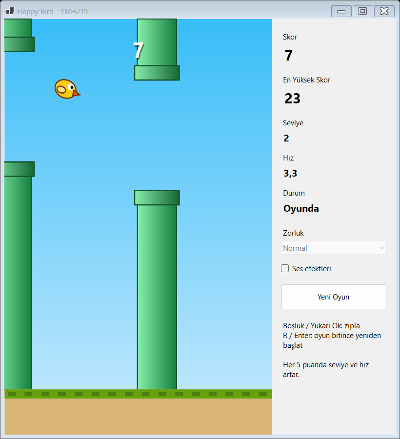
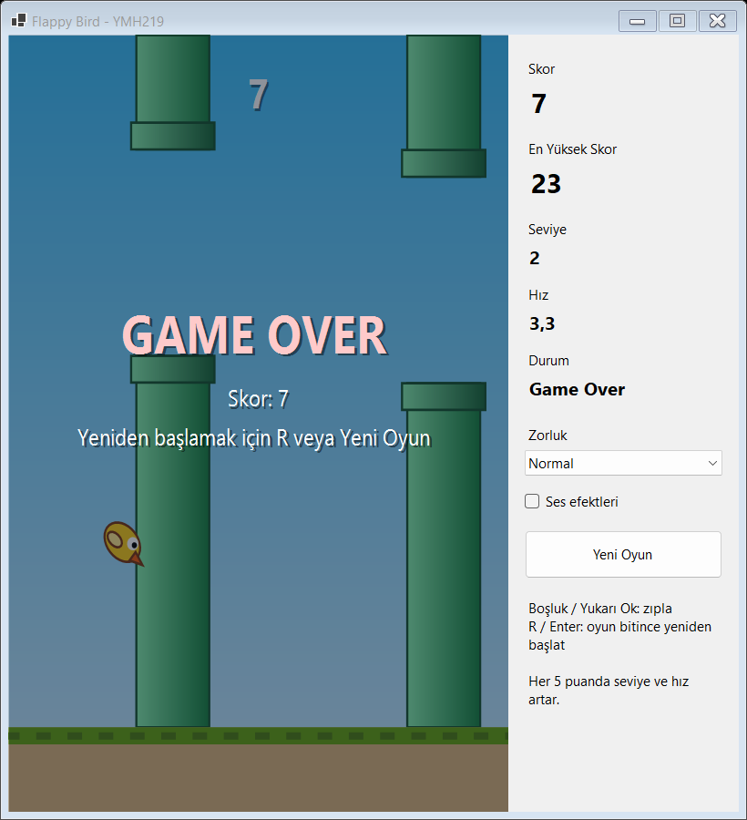

# Flappy Bird Benzeri Masaüstü Oyunu

Windows Forms ile geliştirilen, zamanlayıcı ve klavye olaylarına dayalı basit bir oyun. Amaç; görsel bileşenleri çalışma zamanında hareket ettirmek, çarpışma kontrolü yapmak ve oyun durumunu nesne tabanlı bir yapıyla yönetmektir.

YMH 219 Nesne Tabanlı Programlama dersi uygulama ödevidir.

## Kullanılan Teknolojiler

- C# / .NET 9
- Windows Forms (`Timer`, `KeyDown`/`KeyUp`, GDI+ ile çizim)
- Harici NuGet paketi yoktur.

## Kurulum ve Çalıştırma

Gereksinim: Windows ve [.NET 9 SDK](https://dotnet.microsoft.com/download/dotnet/9.0) veya Visual Studio 2022.

**Visual Studio ile:** `YMH219-FlappyBird.sln` dosyasını açıp `F5` tuşuna basın.

**Komut satırından:**

```
dotnet run --project FlappyBird
```

## Temel Özellikler

- Kuş klavyeyle yükselir, yer çekimiyle düşer.
- Üç engel sağdan sola hareket eder; ekrandan çıkan engel yeniden konumlandırılır.
- Engele veya zemine çarpınca oyun durur ve **Game Over** gösterilir.
- Geçilen her engel skoru artırır.
- **Yeni Oyun** düğmesi veya oyun bitince `R` / `Enter` ile yeniden başlatma.
- En yüksek skor dosyada saklanır.
- Her 5 puanda seviye ve hız artar; Kolay / Normal / Zor seçenekleri ve isteğe bağlı ses efekti vardır.

| Tuş | İşlev |
| --- | --- |
| `Boşluk` veya `Yukarı Ok` | Zıpla / oyunu başlat |
| `R` veya `Enter` | Oyun bitince yeniden başlat |

## Ekran Görüntüleri





## Sınıf Tasarımı

| Sınıf | Görevi |
| --- | --- |
| `GameObject` | Konumlu, güncellenen ve çizilen nesnelerin soyut taban sınıfı |
| `Bird`, `PipePair` | `GameObject`'ten türeyen kuş ve boru çifti |
| `GameEngine` | Skor, seviye, hız, çarpışma ve engel yönetimi; arayüzden bağımsızdır |
| `GameState`, `DifficultyLevel` | Oyun durumu ve zorluk ayarları |
| `HighScoreStore` | En yüksek skorun dosyaya yazılıp okunması |
| `GamePanel` | Oyun alanının çift tamponlu çizimi |
| `MainForm` | Klavye olayları, oyun döngüsü ve skor paneli |

## Bilinen Sınırlamalar ve Geliştirme Notları

- Oyun döngüsü sabit adımlıdır: fizik, zamanlayıcının gerçek tetiklenme sıklığına göre değil geçen süreye göre ilerler.
- Art arda gelen boşlukların yükseklik farkı sınırlıdır, böylece en yüksek hızda bile geçilemeyen engel oluşmaz.
- Windows, arka planda kalan pencerelerin zamanlayıcısını yavaşlatabilir; oyun pencere odaktayken oynanmalıdır.
- En yüksek skor `%LOCALAPPDATA%\YMH219-FlappyBird\highscore.txt` dosyasındadır ve zorluk seviyelerine göre ayrılmaz.
- Yalnızca Windows'ta çalışır.

## Öğrenci

- **Ad Soyad:** Samet Sel
- **Öğrenci No:** `BURAYA-OGRENCI-NUMARASI`
